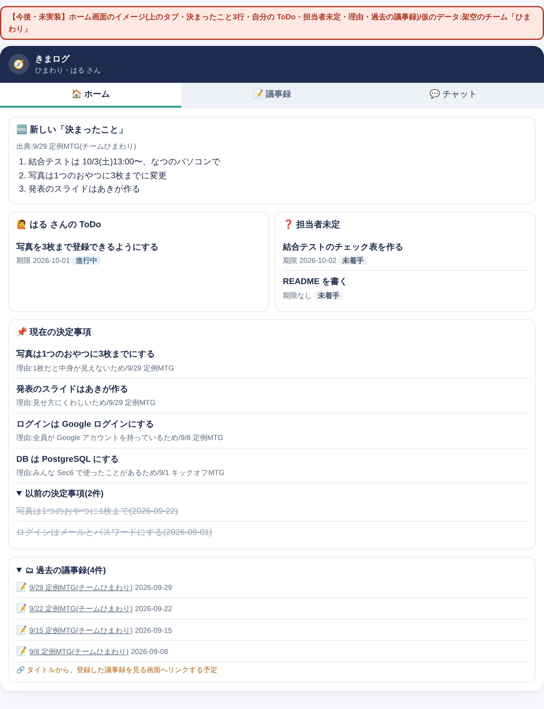

# きまログ

**決まったことを、あとからたどれる。** 会議の議事録から「決まったこと」を取り出してチームの記録として保存し、メンバーの質問に根拠(出典)つきで答える AI アシスタントです。
名前は「決まった」+「ログ(記録)」から。
4人チームで制作したアプリの、個人ポートフォリオ向け公開用コピーです。

## 私の主な担当

- Mac・Windows向けの開発環境構築手順の整備
- PostgreSQLのDB設計、ER図、モデル・マイグレーションの作成
- Mastraの会話メモリと、ユーザー・チーム情報の連携
- 認証済みユーザーの議事録をRAGに登録するAPI
- 議事録の確認・確定、決定事項の履歴・一覧取得API

※スクールでの学習・チーム開発として取り組んだ内容です。

## できること
| 画面 | できること |
|---|---|
| ログイン(`/login`) | Firebase の Google ログイン。チームに登録されたメンバーだけが使える |
| 議事録(`/minutes`)=機能① | 議事録を貼る → AI(Mastra の Workflow)が「決まったこと3行・決定事項・未決事項・ToDo(担当・期限)」に整理 → 人が確認・直して保存 → 検索用の本棚(RAG)にも登録。登録だけ失敗したら再試行できる |
| チャット(`/`)=機能② | 質問すると、自分のチームの議事録を検索して答える。答えに「関連する議事録」(議事録名・日付)をつける。続けて質問しても毎回検索する |
| ダッシュボード(`/dashboard`) | 決定事項の一覧。「最新の決定」と、変わる前の「以前の決定」 |

## 特徴
- AI が整理し、**人が確認してから**チームの記録として保存する
- 「決定と理由」「提案と決定のちがい」まで答える/決定が変わると前の決定を「以前の決定」として残す
- 出典は AI に作らせず、検索結果からプログラムで表示する
- チームID は画面から受け取らずサーバーで決める → ほかのチームのデータは見えない

## 範囲(MUST・WANT)
| 区分 | 機能 | 様子 |
|---|---|---|
| 課題の MUST | Mastra/Workflow・Tool・Agent/メモリ管理/RAG/認証認可/評価基準と継続テスト(3回) | ✅ |
| チームの MUST | ① 議事録 → 決まったこと3行・ToDo/② 根拠つき AI チャット/決定事項の一覧(現在・以前) | ✅ |
| WANT | RAG 登録の再試行 | ✅ |
| 今後 | ホーム(決まったこと3行・自分の ToDo・担当者未定・理由・過去の議事録)/画面のタブ/議事録エクスポート/出典のしぼりこみ/保存のあとに直す・消す/抽出の速さ | 【今後・未実装】 |

### 今後のイメージ【今後・未実装】
ホーム画面で「新しい決まったこと」「自分の ToDo」「担当者未定」「理由つきの決定事項」「過去の議事録」を一目で見られるようにし、上のタブで画面を切りかえる案です(仮のデータ)。



## しくみ
Next.js 16(画面)→ Mastra(Agent・Workflow・Tool・メモリ・RAG/OpenRouter)・FastAPI → PostgreSQL 18 + pgvector/Firebase Authentication。くわしくは [システム設計図](docs/architecture.md)

## ドキュメント一覧
| 書類 | ファイル |
|---|---|
| 環境構築の手順(Mac・Windows) | [docs/setup/](docs/setup/) |
| 要件定義書 | [docs/requirements.md](docs/requirements.md) |
| システム設計図 | [docs/architecture.md](docs/architecture.md) |
| API 仕様書・エラー一覧 | [docs/api.md](docs/api.md) |
| ER図(DB 設計) | [docs/database.md](docs/database.md) |
| AI 設計 | [docs/ai-design.md](docs/ai-design.md) |
| 評価基準・架空サンプル | [docs/eval/criteria.md](docs/eval/criteria.md) |

会議記録・個人別の検証記録・内部運用資料・過去のGit履歴は含めていません。

## 起動手順（Mac・Windows対応）

> はじめての人は、AI エージェントといっしょに1つずつ進められる [docs/setup/](docs/setup/) の手順書がおすすめです(Mac:mac.md/Windows:windows.md)。

このプロジェクトは、Next.js・FastAPI・Mastra・PostgreSQL（pgvector）で構成されています。

### 1. 事前に必要なもの

- Git
- Docker Desktop（起動しておく）
- Node.js / npm
- Python環境管理ツール `uv`

Windowsでは、Docker DesktopのWSL 2バックエンドを利用してください。

### 2. 公開用フォルダを開く

公開用リポジトリ：https://github.com/erina24/kimarogu-public

「Code」→「Download ZIP」からダウンロードし、解凍したフォルダを開いてください。
元チームのリポジトリの過去のGit履歴は含めていません。

### 3. DBの環境変数を設定する

プロジェクト直下の `.env.example` をコピーして、`.env` を作成します。

**Mac（ターミナル）**

`test -e .env || cp .env.example .env`

**Windows（PowerShell）**

`if (-not (Test-Path .env)) { Copy-Item .env.example .env }`

既存の設定ファイルは上書きせず、初回に作成した `.env` を開いて以下を設定します。既存DBがある場合は接続情報を勝手に変えません。

- `POSTGRES_USER=sec8_user`
- `POSTGRES_PASSWORD=各自で設定するDBパスワード`
- `POSTGRES_DB=sec8_db`

パスワードは各自のローカル環境で設定してください。チームで同じ値にする必要はありません。

`.env` や認証情報はGitHubにコミットしないでください。

### 4. PostgreSQLを起動する

Mac・Windows共通で、プロジェクト直下から実行します。

`docker compose config --quiet`

`docker compose up -d db`

`docker compose ps`

`sec8-db` の状態が `healthy` になれば、DB起動成功です。

DB接続先：`localhost:5435`

### 5. pgvectorを有効化する

以下を実行します。

`docker compose exec db psql -U sec8_user -d sec8_db -c "CREATE EXTENSION IF NOT EXISTS vector;"`

バージョン確認：

`docker compose exec db psql -U sec8_user -d sec8_db -c "SELECT extname, extversion FROM pg_extension WHERE extname = 'vector';"`

`vector` とバージョン番号が表示されれば成功です。

### 6. FastAPIのDB接続設定

`backend/.env.example` を `backend/.env` にコピーします。

Mac：

`test -e backend/.env || cp backend/.env.example backend/.env`

Windows：

`if (-not (Test-Path backend/.env)) { Copy-Item backend/.env.example backend/.env }`

`DATABASE_URL` の `your-password` を、手順3で設定したDBパスワードに置き換えます。

DB接続先：

`postgresql+psycopg://sec8_user:<DBパスワード>@localhost:5435/sec8_db`

DBパスワードにURLの予約文字がある場合は、適切にパーセントエンコードしてください。

`backend/.env` の `FIREBASE_CREDENTIALS_PATH` に指定した場所へサービスアカウントJSONを配置します。鍵の準備は [Mac手順のB4](docs/setup/mac.md#b4-firebaseの鍵を配置する) / [Windows手順のB4](docs/setup/windows.md#b4-firebaseの鍵を配置する) を参照してください。

バックエンドの依存関係をインストールし、DBへの接続を確認します。

`cd backend`

`uv sync --frozen --python 3.12`

`uv run alembic current`

続けて、テーブルを作ります(`uv run alembic upgrade head` → `uv run alembic current` で `22d5664d47e8 (head)` が出れば成功)。

`uv run alembic upgrade head`

### 7. Next.js・Mastraの準備

#### ① 環境変数ファイルを作成する

プロジェクト直下（`kimarogu-public`）で、それぞれの環境変数ファイルを作成します。

**Mac（ターミナル）**

```bash
test -e frontend/.env.local || cp frontend/.env.example frontend/.env.local
test -e mastra/.env || cp mastra/.env.example mastra/.env
```

**Windows（PowerShell）**

```powershell
if (-not (Test-Path frontend/.env.local)) { Copy-Item frontend/.env.example frontend/.env.local }
if (-not (Test-Path mastra/.env)) { Copy-Item mastra/.env.example mastra/.env }
```

環境変数ファイルは、サービスごとに次のように使い分けます。

| サービス | 設定ファイル |
|---|---|
| Next.js | `frontend/.env.local` |
| FastAPI | `backend/.env` |
| Mastra | `mastra/.env` |
| PostgreSQL（Docker） | プロジェクト直下の `.env` |

- Next.jsにはFirebaseのWeb用設定4項目が必要です（[MacのB6・B7](docs/setup/mac.md#b6-firebaseのweb用設定を確認する) / [WindowsのB6・B7](docs/setup/windows.md#b6-firebaseのweb用設定を確認する)）。
- `MASTRA_URL` と `MASTRA_API_URL` は同じMastra接続先にします。`RAG_INGEST_SECRET` はNext.jsとMastraで同じ値を設定します。
- MastraにはOpenRouterのAPIキーとPostgreSQLの接続情報が必要です。
- パスワードやAPIキーなどの秘密情報はGitHubにコミットしないでください。

#### ② FastAPIの接続先を設定する

`frontend/.env.local` を開き、次の項目を設定してください。

```dotenv
API_BASE_URL=http://127.0.0.1:8001
```

FastAPIの起動ポートは **8001** に統一します。

※ `frontend/.env.example` の初期値が8000の場合も、各自の `.env.local` では8001に変更してください。

※ 環境変数を変更した場合は、Next.jsを再起動してください。

#### ③ 依存関係をインストールする

Next.jsとMastraは、それぞれのフォルダでインストールします。

**Next.js**

プロジェクト直下から実行します。

```bash
cd frontend
npm ci
```

**Mastra**

プロジェクト直下から実行します。

```bash
cd mastra
npm ci
```

※ Windows / PowerShellでは、この先も含め `npm` を `npm.cmd` に読み替えてください（例：`npm.cmd ci`、`npm.cmd run dev`）。実行ポリシーの変更は不要です。

※ それぞれ別のターミナルで実行するか、一度プロジェクト直下に戻ってから実行してください。

依存関係のインストールが完了したら、次の「8. 開発サーバーを起動する」に進んでください。

### 8. 開発サーバーを起動する

それぞれ別のターミナルで起動します。

**FastAPI**

`cd backend`

`uv run fastapi dev app/main.py --port 8001`

APIドキュメント：`http://127.0.0.1:8001/docs`

※FirebaseサービスアカウントJSONを `backend/.env` に指定した場所へ配置する必要があります。ファイルがない場合、FastAPIは起動途中で停止します。

**Mastra**

`cd mastra`

`npm run dev`

Mastra Studio：`http://localhost:4111`

※Studio の Agents にチャット・議事録抽出の Agent、Workflows に `minutes-extraction-workflow` が出れば成功です。`mastra/.env` に OpenRouter のキーと `RAG_INGEST_SECRET`(frontend と同じ値)が必要です。

**Next.js**

`cd frontend`

`npm run dev`

画面：`http://localhost:3000`

※3000番が使用中の場合は別のポートで進めず、既存のサービスを確認して相談してください。起動ログが3000番であることを確認します。FastAPIの接続先は手順7で設定した frontend/.env.local の API_BASE_URL を使用します。

### 9. DBの停止・再起動

DBを停止する：

`docker compose stop db`

DBを再起動する：

`docker compose up -d db`

DBコンテナを停止・削除する：

`docker compose down`

※DBの保存データはDockerボリュームに保持されます。

**注意：`docker compose down -v` はDBの保存データも削除するため、通常の停止時には使用しないでください。**

### 10. よくあるエラー

- `POSTGRES_PASSWORD variable is not set`：プロジェクト直下の `.env` を確認
- `port is already allocated`：ポート5435の使用状況を確認
- `connection refused`：Docker Desktopと `sec8-db` の起動状態を確認
- `firebase-service-account.json` が見つからない：Firebaseの認証ファイルを配置
- Mastra Studioで `No Agents yet`：`mastra` フォルダで起動しているか、`npm run dev` のエラーを確認
- ログイン後に「利用権限がありません」：このPCの DB にメンバーが未登録([docs/setup/](docs/setup/) の E2〜E4)

### 初回ログイン前の準備

自分で管理するFirebaseプロジェクトと検証用アカウントを用意してください。
Google認証だけではアプリを利用できず、ローカルDBへの所属登録が必要です。
現行の登録スクリプトは4人分の登録情報を要求します。詳細は [初回登録手順](docs/setup/mac.md#e2-4人分の登録情報を準備する) を参照してください。
実際のチームの鍵・UID・DBデータは配布していません。

## 動作確認状況

- 成功：フロントエンドテスト8件、バックエンドテスト7件（インメモリDB）、会話メモリ識別テスト4項目、ESLint、Mastraの型検査・ビルド、Python依存関係の整合性チェック。
- フロントエンド本番ビルド：コンパイル・型検査は成功。Firebase設定不足により `/login` の事前生成で停止し、ビルド全体は未完了。
- 未確認：実DBへの接続・マイグレーション適用、ログイン、外部AI・RAGを含む一連の動作。

`.env`・認証鍵（`backend/secrets/`）・ユーザー登録データ・依存パッケージ・ビルド生成物はGitの除外対象です。`.env.example` は設定例として収録しています。

## このリポジトリについて

Ms.Engineerの4人チームで制作した「きまログ」を、
スクールの公開許可を得て個人のポートフォリオ用に複製しています。
アプリ全体はチームの共同成果です。


