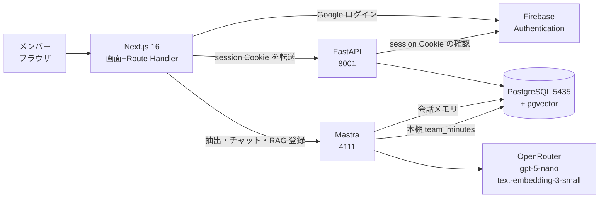
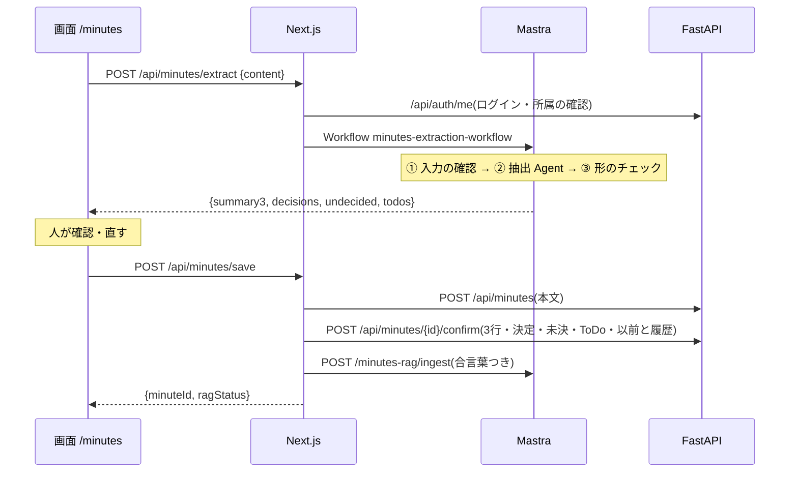
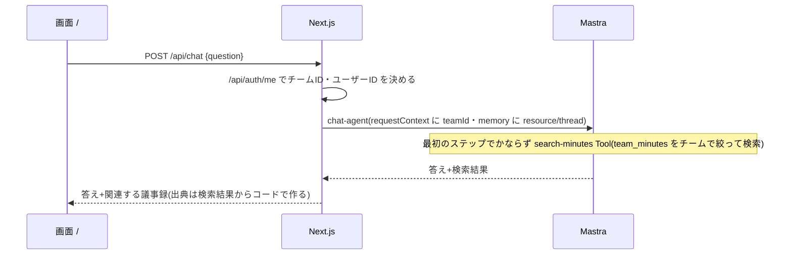

# システム設計図(きまログ)

## 全体のしくみ

- **案B**:AI は Next.js のサーバーから Mastra を呼ぶ/業務データ(議事録・決定事項・ToDo)の保存と一覧は Next.js → FastAPI
- チームID・ユーザーID は、画面から受け取らず、サーバー側で `/api/auth/me` から決める

## 使う技術
| 層 | 技術 |
|---|---|
| 画面 | Next.js 16(App Router・Tailwind CSS v4) |
| API | FastAPI(SQLAlchemy・Alembic) |
| AI | Mastra(Agent・Workflow・Tool・メモリ・RAG) |
| DB | PostgreSQL 18 + pgvector(Docker・sec8-db) |
| 認証 | Firebase Authentication(Google ログイン)+ session Cookie |
| LLM | OpenRouter 経由:チャット・抽出 `openai/gpt-5-nano`/埋め込み `openai/text-embedding-3-small` |

## 機能ごとの流れ

### 機能① 議事録 → 決まったこと3行・ToDo(/minutes)

- RAG 登録だけ失敗したときは「再試行」ボタン(`POST /api/minutes/rag-retry` → FastAPI `GET /api/minutes/{id}` → Mastra)

### 機能② 根拠つき AI チャット(/)

### 決定事項の一覧(/dashboard)
- Next.js(サーバー)→ FastAPI `GET /api/decisions?status=all` → 「最新の決定」(current)と「以前の決定」(previous)

## メモリ・DB・RAG のちがい
| | 中身 | 置き場所 |
|---|---|---|
| メモリ | 会話の履歴。回答時に直近20メッセージを参照する（保存件数の上限ではない）。チームID+ユーザーID で分ける | PostgreSQL(Mastra の PostgresStore) |
| DB | 議事録・決定事項(現在/以前)・変更履歴・未決事項・ToDo・チーム・ユーザー | PostgreSQL(FastAPI・7つの表 → database.md) |
| RAG | 議事録の本文を数字(ベクトル)にした本棚 `team_minutes`。チームID・議事録名・日付つき | PostgreSQL + pgvector(Mastra) |

## 守っていること(セキュリティ)
- チームID は画面から受け取らない(サーバーで決める)→ ほかのチームのデータは見えない
- RAG 登録の API は合言葉(`RAG_INGEST_SECRET`)がないと使えない
- 出典は AI に作らせず、検索結果からコードで表示する
- `.env`・Firebase の鍵・API キーはコミットしない

## ポート
| サービス | ポート |
|---|---|
| Next.js | 3000 |
| Mastra | 4111 |
| FastAPI | 8001 |
| PostgreSQL | 5435 |
