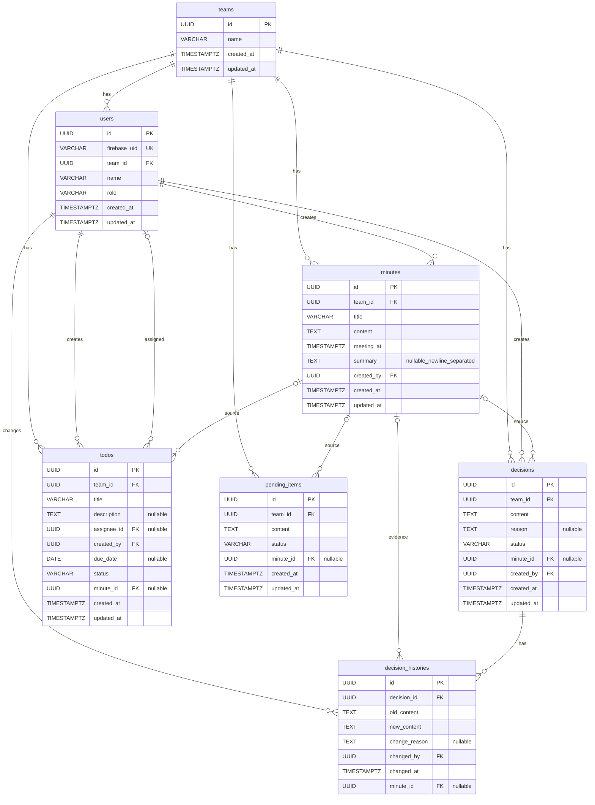

# DB設計・ER図

> 対象：きまログ
> ※7テーブルは `backend/app/models.py` とマイグレーション `22d5664d47e8` で実装ずみ。下の内容は実装と同じです。

## 1. 決定事項【確定】

- DBは7テーブル構成とする
- 決定事項の変更理由を履歴として保存する
- ToDoは登録者と担当者を分けて管理する
- 担当者が決まっていないToDoも登録できる
- 議事録に紐づかないToDoも登録できる
- 議事録に紐づかない決定事項も登録できる
- 議事録本文の編集履歴は保存せず、確定した決定事項の変更履歴を管理する
- AIが生成した1〜3行の要約は、人が確認・修正した後、改行区切りのTEXTで保存する
- MVPではチームAと4人のユーザー情報をDBへ事前登録する
- 議事録のDB保存成功後にRAG登録を実行する
- RAG登録時の議事録日付はYYYY-MM-DD形式とする

## 2. テーブル一覧

| テーブル | 保存する情報 |
|---|---|
| `teams` | チーム情報 |
| `users` | ユーザー・所属チーム・役割 |
| `minutes` | 議事録のタイトル・本文・会議日時 |
| `decisions` | 決定事項・現在／以前の状態 |
| `todos` | ToDo・登録者・担当者・期限・進捗 |
| `pending_items` | 未決事項 |
| `decision_histories` | 決定事項の変更履歴・変更理由 |

## 3. ER図【実装ずみ】

**ER図の凡例**

- `PK`：主キー（データを識別するID）
- `FK`：外部キー（別テーブルを参照するID）
- `UK`：重複不可の項目
- `nullable`：NULL（未設定）を許可

※ ER図の型・NULL許可は `backend/app/models.py` と一致しています。

## 4. テーブル詳細設計【実装ずみ】

### 4-1. teams（チーム）

| カラム名 | 型 | 必須 | 説明 |
|---|---|---|---|
| `id` | UUID | ○ | チームID（主キー） |
| `name` | VARCHAR(100) | ○ | チーム名 |
| `created_at` | TIMESTAMPTZ | ○ | 作成日時 |
| `updated_at` | TIMESTAMPTZ | ○ | 更新日時 |

### 4-2. users（ユーザー）

| カラム名 | 型 | 必須 | 説明 |
|---|---|---|---|
| `id` | UUID | ○ | ユーザーID（主キー） |
| `firebase_uid` | VARCHAR(128) | ○ | Firebaseの認証ID（重複不可） |
| `team_id` | UUID | ○ | 所属チームID（teams.id） |
| `name` | VARCHAR(100) | ○ | 表示名 |
| `role` | VARCHAR(30) | ○ | チーム内の役割 |
| `created_at` | TIMESTAMPTZ | ○ | 作成日時 |
| `updated_at` | TIMESTAMPTZ | ○ | 更新日時 |

**設計上のポイント**

- MVPでは1ユーザー1チーム構成とし、`users.team_id` で所属チームを管理する
- 複数チームへの所属を許可するかは、今後チームで確認する
- MVPではチームAと4人のユーザーをDBに事前登録する
- チーム作成・メンバー招待画面はMVPでは作成せず、10/25にWANTとして再検討する
- Firebase UIDとDBの `users.firebase_uid` を紐づける
- UIDの取得・初期登録は `scripts/seed_team.py`(6章)
- `role` は今は `member`(6章)

### 4-3. minutes（議事録）

| カラム名 | 型 | 必須 | 説明 |
|---|---|---|---|
| `id` | UUID | ○ | 議事録ID（主キー） |
| `team_id` | UUID | ○ | 所属チームID（teams.id） |
| `title` | VARCHAR(200) | ○ | 議事録タイトル |
| `content` | TEXT | ○ | 議事録本文 |
| `meeting_at` | TIMESTAMPTZ | ○ | 会議日時 |
| `summary` | TEXT | — | 人が確認・修正した1〜3行の要約（改行区切りで保存） |
| `created_by` | UUID | ○ | 登録者ID（users.id） |
| `created_at` | TIMESTAMPTZ | ○ | 作成日時 |
| `updated_at` | TIMESTAMPTZ | ○ | 更新日時 |

**設計上のポイント**

- 議事録はチームごとに管理する
- RAG登録時は、議事録ID・チームID・タイトル・日付・本文を渡す
- `meeting_at` はDBではTIMESTAMPTZ型で保存し、RAG登録時に`YYYY-MM-DD`形式の日付へ変換する
- RAG登録は、人が議事録を確認・修正し、通常DBへの保存が成功した後に実行する
- 議事録本文の編集履歴は保存しない
- `summary` は人が確認・修正した1〜3行の要約を、改行区切りのTEXTで保存する
- 要約が未生成の場合も議事録を登録できるように、`summary` はNULLを許可する
- AIの出力は1〜3要素のリストとし、DB保存時に改行区切りの文字列へ変換する

### 4-4. decisions（決定事項）

| カラム名 | 型 | 必須 | 説明 |
|---|---|---|---|
| `id` | UUID | ○ | 決定事項ID（主キー） |
| `team_id` | UUID | ○ | 所属チームID（teams.id） |
| `content` | TEXT | ○ | 決定内容 |
| `reason` | TEXT | — | 決定した理由（記載がない場合は未設定） |
| `status` | VARCHAR(20) | ○ | current / previous（現在／以前） |
| `minute_id` | UUID | — | 根拠となる議事録ID（minutes.id） |
| `created_by` | UUID | ○ | 登録者ID（users.id） |
| `created_at` | TIMESTAMPTZ | ○ | 作成日時 |
| `updated_at` | TIMESTAMPTZ | ○ | 更新日時 |

**設計上のポイント**

- 議事録から抽出した決定事項を登録できる
- 議事録に紐づかない決定事項も手動登録できる
- `minute_id` はNULLを許可する
- 決定事項は「現在／以前」を区別する
- `reason` は任意項目とし、理由が記載されていない場合も決定事項を保存できる
- 変更前後の内容と変更理由は `decision_histories` に記録する
- `decision_histories.decision_id` は古い決定のIDを参照し、変更前後の内容を `old_content` / `new_content` に残す。新しい決定のIDを直接参照するカラムはない(6章)

### 4-5. todos（ToDo管理）

| カラム名 | 型 | 必須 | 説明 |
|---|---|---|---|
| `id` | UUID | ○ | ToDo ID（主キー） |
| `team_id` | UUID | ○ | 所属チームID（teams.id） |
| `title` | VARCHAR(200) | ○ | 作業内容 |
| `description` | TEXT | — | 詳細説明 |
| `assignee_id` | UUID | — | 担当者ID（users.id） |
| `created_by` | UUID | ○ | 登録者ID（users.id） |
| `due_date` | DATE | — | 完了期限 |
| `status` | VARCHAR(20) | ○ | not_started / in_progress / done（未着手／進行中／完了） |
| `minute_id` | UUID | — | 関連議事録ID（minutes.id） |
| `created_at` | TIMESTAMPTZ | ○ | 作成日時 |
| `updated_at` | TIMESTAMPTZ | ○ | 更新日時 |

**設計上のポイント**

- 登録者と担当者は別々に管理する
- 自分が担当しないToDoも登録できる
- `assignee_id` はNULLを許可する（担当者未定）
- `minute_id` はNULLを許可する（議事録との関連なし）
- `due_date` はNULLを許可する（期限未定）
- 担当者には同じチームのユーザーを指定する

### 4-6. pending_items（未決事項）

| カラム名 | 型 | 必須 | 説明 |
|---|---|---|---|
| `id` | UUID | ○ | 未決事項ID（主キー） |
| `team_id` | UUID | ○ | 所属チームID（teams.id） |
| `content` | TEXT | ○ | 未決事項の内容 |
| `status` | VARCHAR(20) | ○ | unresolved / resolved（未解決／解決済み） |
| `minute_id` | UUID | — | 関連議事録ID（minutes.id） |
| `created_at` | TIMESTAMPTZ | ○ | 作成日時 |
| `updated_at` | TIMESTAMPTZ | ○ | 更新日時 |

**設計上のポイント**

- 会議で決まらなかった事項を管理する
- 解決した場合は `status` を更新する
- `minute_id` は任意(NULL 可)

### 4-7. decision_histories（決定事項の更新履歴）

| カラム名 | 型 | 必須 | 説明 |
|---|---|---|---|
| `id` | UUID | ○ | 履歴ID（主キー） |
| `decision_id` | UUID | ○ | 対象の決定事項ID（decisions.id） |
| `old_content` | TEXT | ○ | 変更前の内容 |
| `new_content` | TEXT | ○ | 変更後の内容 |
| `change_reason` | TEXT | — | 変更理由（記載がない場合はNULL） |
| `changed_by` | UUID | ○ | 変更したユーザーID（users.id） |
| `changed_at` | TIMESTAMPTZ | ○ | 変更日時 |
| `minute_id` | UUID | — | 変更の根拠となった議事録ID（minutes.id） |

**設計上のポイント**

- 確定した決定事項を変更したときに履歴を残す
- `old_content` に変更前の内容を記録する
- `new_content` に変更後の内容を記録する
- `change_reason` はNULLを許可し、理由が分かる場合に記録する
- `changed_by` と `changed_at` で変更者と変更日時を管理する
- `minute_id` はNULLを許可する（根拠議事録なし）
- 「現在／以前」は `decisions.status`、変わった内容と理由は `decision_histories`(6章)

## 5. 共通設計ルール

- 主キーはUUIDで統一する
- 日時はタイムゾーン付きで保存する
- 作成日時・更新日時は既存の `TimestampMixin` を利用する
- チームに属するデータは、ログイン情報から確定したチームIDでアクセスを制限する
- ブラウザから送られたユーザーID・チームIDをそのまま信用しない
- 登録者・担当者・関連議事録が同じチームに属することをサーバー側で確認する
- RAG検索データとMastra会話メモリは、今回の7テーブルとは別に管理する
- 外部キー制約はモデルどおり。削除の機能は今後(削除時の動作もそのときに決める)

## 6. 実装で決まったこと(10/28 時点・【要確認】の答え)

| 確認していたこと | 実装での答え |
|---|---|
| 1ユーザーの所属チーム | MVP は1人1チーム(`users.team_id`)。複数チームは今後 |
| UID の取得・初期登録 | Firebase コンソールで4人の UID を確認 → `backend/seed-users.json`(gitignore)→ `scripts/seed_team.py`(確認 → `--apply`) |
| `role` の種類 | 今は `member`。権限の差はつけていない |
| `created_by` | 保存したログインユーザーの ID(`/api/auth/me` で決める) |
| 決定事項の「現在/以前」 | 確定保存で、前の決定が見つかれば `previous` にし、新しい決定を `current` で保存。`decision_histories` に old/new を残す |
| 前の決定が見つからないとき | そのまま新しい決定(`current`)として保存 |
| 担当が見つからない ToDo | `assignee_id` は NULL(担当者未定)。`status` は `not_started` |
| 未決事項 | `status` は `unresolved`。`minute_id` は NULL 可 |
| 期限 | `due_date` は DATE・NULL 可 |
| 議事録のチームの分離 | すべての読み書きで、ログインユーザーの `team_id` でしぼる(ほかのチームは 403/404) |
| RAG のメタデータ | 本棚 `team_minutes` に minuteId・teamId・title・meetingAt(YYYY-MM-DD・日本時間)・本文 |
| 議事録の修正・削除時の RAG | 今後(WANT 12)。RAG 登録だけ失敗したときの再試行は実装ずみ |

## 7. 実装の記録

- モデル:`backend/app/models.py`/マイグレーション:`backend/alembic/versions/22d5664d47e8_create_seven_core_tables.py`
- 確定保存:`backend/app/routers/minutes_confirm.py`/決定事項の一覧:`backend/app/routers/decisions.py`(`GET /api/decisions?status=current|all`)
- 各PCでのテーブル作成:`uv run alembic upgrade head`(手順は `docs/setup/`)
